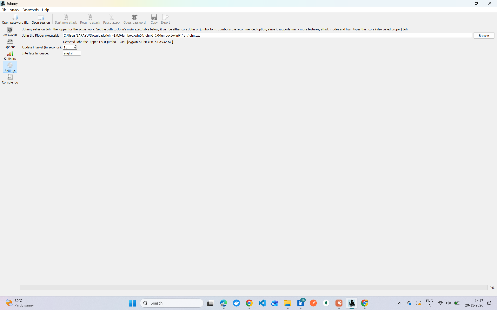
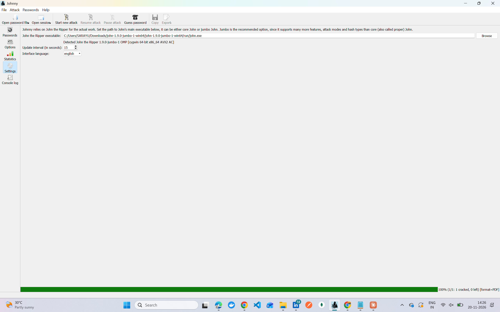
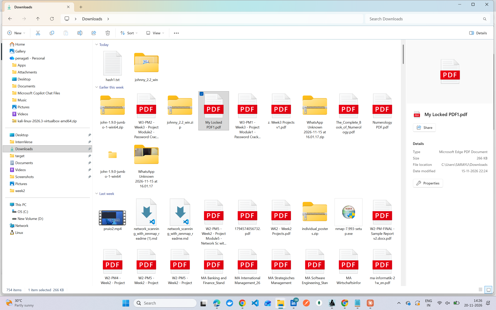
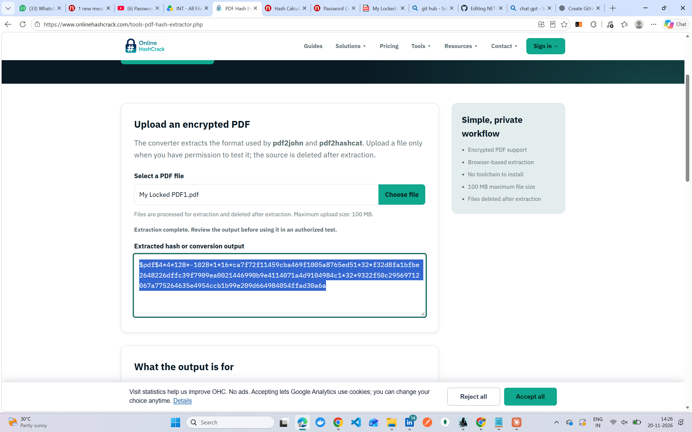
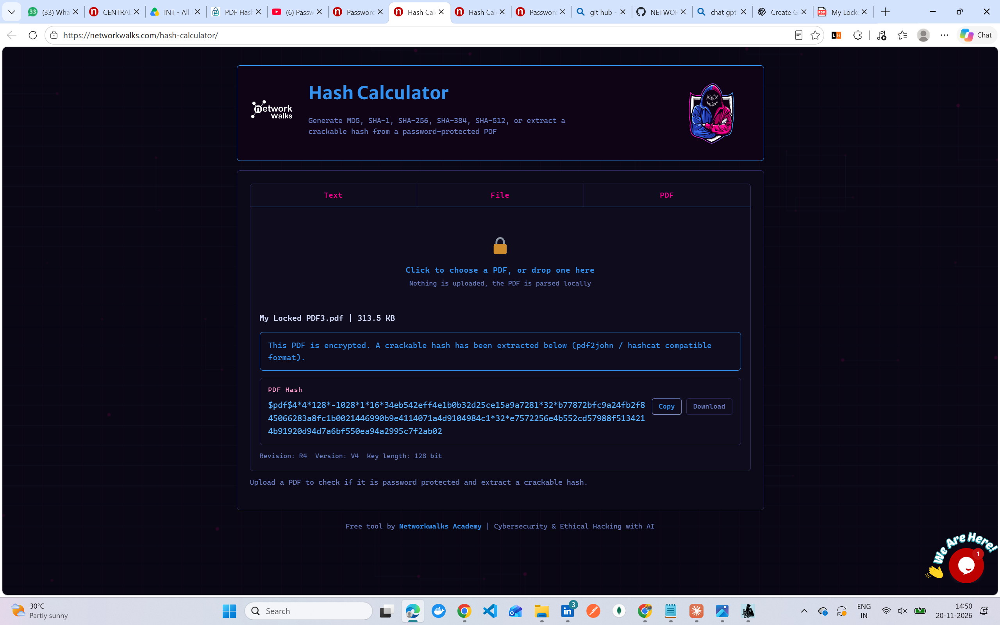
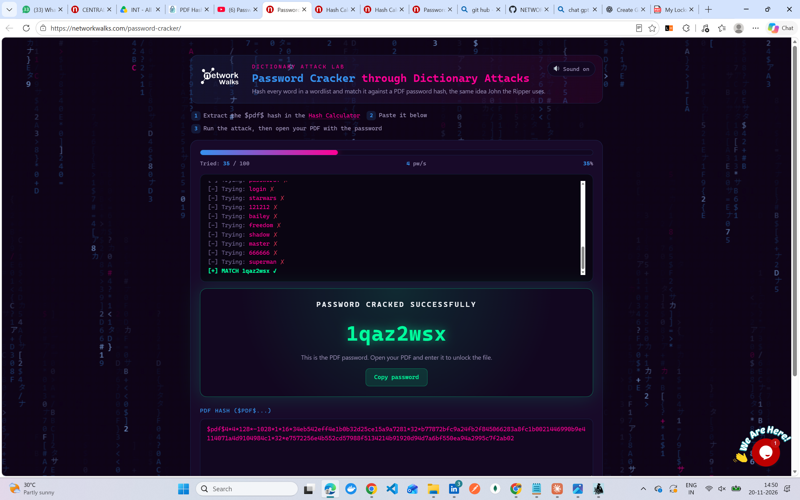

# NETWORKWALKS-BO84-WK3-CYBERSECURITY-PASSWORD-CRACKING

## Password Cracking – Cybersecurity Lab (Week 3)

This repository contains two practical cybersecurity projects demonstrating password auditing of password-protected PDF files.

### Project Modules

1. **Module 1:** Password Cracking using John the Ripper (JTR) and Johnny GUI.
2. **Module 2:** Password Cracking using Networkwalks Tools.

**Important:** These techniques should only be used on files that you own or have permission to test.

---

## Module 1: John the Ripper (JTR) and Johnny GUI

### Objective
To understand how John the Ripper and Johnny GUI can be used to audit the password strength of a protected PDF file.

### Tools Used
- John the Ripper
- Johnny GUI
- PDF Hash Extractor

### Steps Performed
1. Download and install John the Ripper.
2. Install and open Johnny GUI.
3. Configure the John the Ripper executable in Johnny settings.
4. Extract the PDF hash using a PDF Hash Extractor.
5. Copy the complete hash starting with `$pdf$`.
6. Save the hash in a file named `hash1.txt`.
7. Open the hash file in Johnny.
8. Select Start New Attack.
9. Wait for the password audit to finish.
10. Verify the recovered password by opening the sample PDF.

### Screenshots

### Expected Learning Outcome
Understand how John the Ripper processes password hashes and how password auditing works using a graphical interface.

---

## Module 2: Networkwalks Password Cracking Tools

### Objective
To extract a PDF password hash and perform a dictionary-based password audit using Networkwalks online tools.

### Tools Used
- [Networkwalks Hash Calculator](https://networkwalks.com/hash-calculator/)
- [Networkwalks Password Cracker](https://networkwalks.com/password-cracker/)

### Steps Performed
1. Download the sample protected PDF.
2. Open the Networkwalks Hash Calculator.
3. Upload the protected PDF.
4. Copy the extracted PDF hash.
5. Open the Networkwalks Password Cracker.
6. Paste the PDF hash.
7. Select the available wordlist.
8. Click Start Cracking.
9. Wait for the tool to complete the process.
10. Enter the recovered password to open the PDF.

### Screenshots

### Expected Learning Outcome
Understand PDF hash extraction, dictionary attacks, and browser-based password auditing.

---

## Key Concepts Learned

- **Password Hashing:** Converting password data into a hash representation.
- **Hash Extraction:** Extracting password hash information from protected PDF files.
- **Dictionary Attack:** Testing password candidates using a wordlist.
- **Password Security:** Understanding the importance of strong passwords.
- **Encryption vs Hashing:** Understanding the difference between reversible encryption and one-way hashing.

---

## Comparison of Both Modules

| Feature | Module 1 | Module 2 |
|---|---|---|
| Tool | John the Ripper | Networkwalks |
| Interface | Desktop GUI | Web Browser |
| Hash Extraction | External Extractor | Hash Calculator |
| Password Auditing | Johnny GUI | Password Cracker |
| Method | John the Ripper audit | Dictionary Attack |

---

## Security Recommendations

- Use strong and unique passwords.
- Avoid common and predictable passwords.
- Never reuse passwords.
- Use a trusted password manager.
- Keep sensitive files and hashes private.
- Perform password auditing only with authorization.

---

## Conclusion

Through these two practical modules, I learned about PDF password hash extraction, password auditing, dictionary attacks, and the importance of strong password security.

Both tools provided practical exposure to cybersecurity and ethical hacking concepts.

---

## References

- [Networkwalks Official Website](https://networkwalks.com/)
- [John the Ripper](https://www.openwall.com/john/)
- [Networkwalks Hash Calculator](https://networkwalks.com/hash-calculator/)
- [Networkwalks Password Cracker](https://networkwalks.com/password-cracker/)
